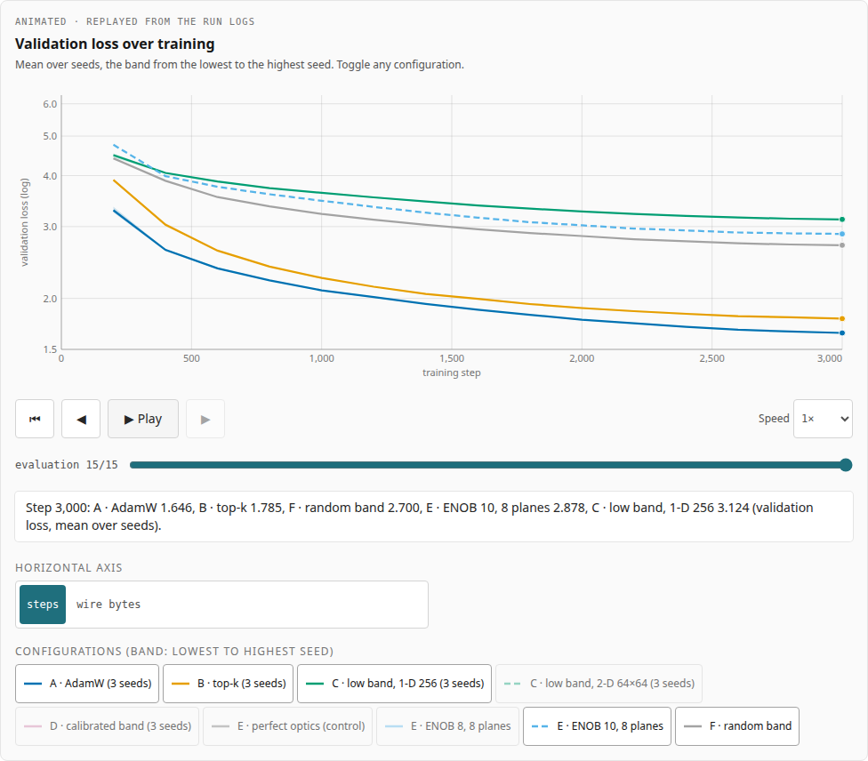
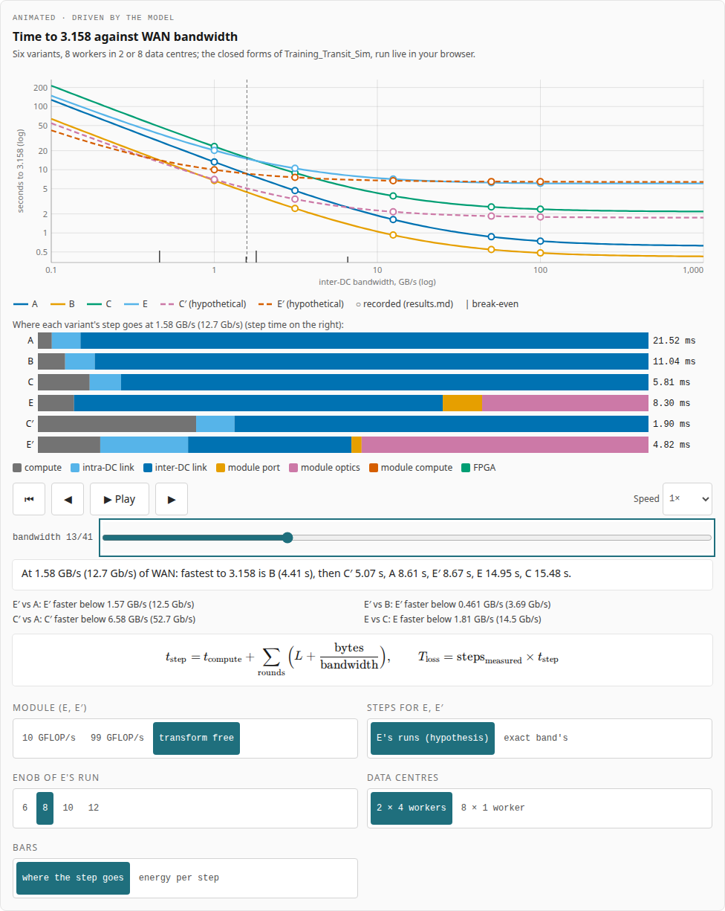
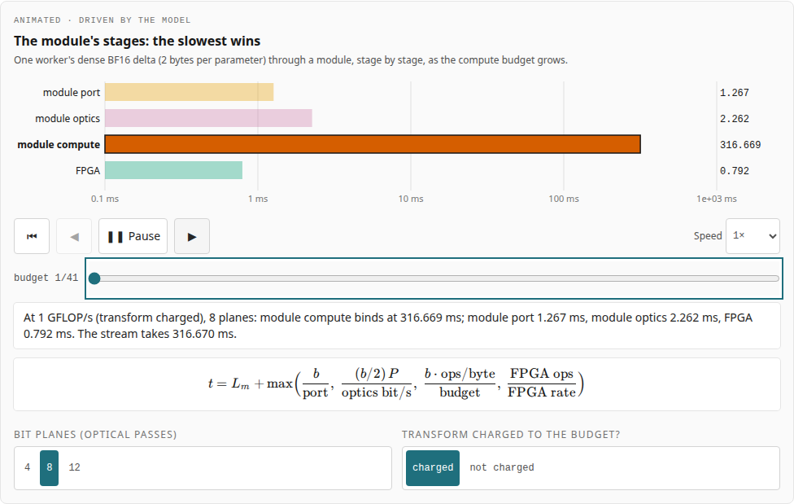
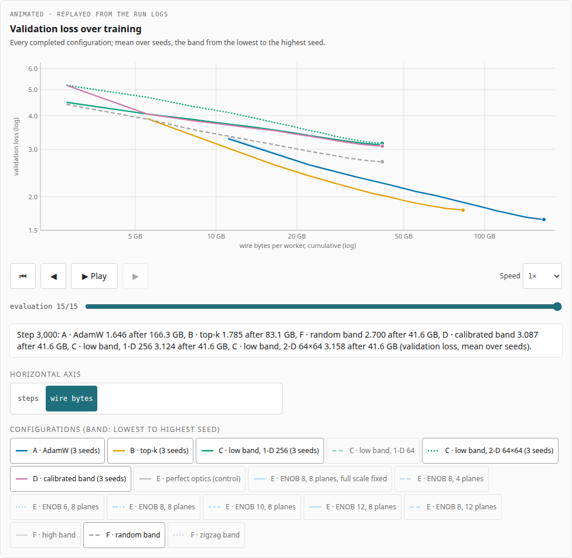
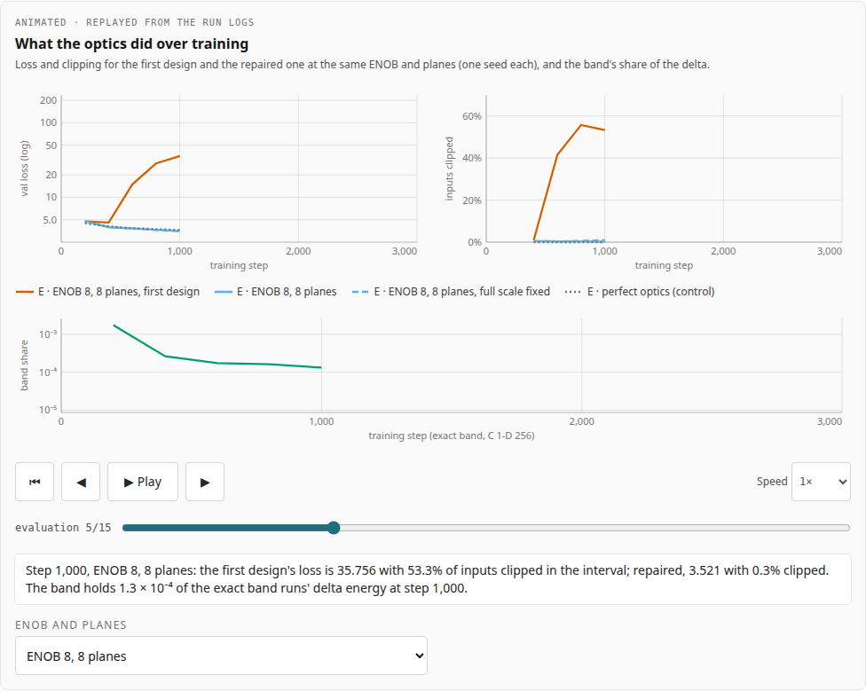

# Compute in Transit: Results

Can DeMo's top-k gradient compression be replaced by a **fixed frequency band**, which needs no comparisons and so
suits a photonic link module (Kundu et al., [arXiv:2608.21536](https://arxiv.org/abs/2608.21536)), without losing
convergence? And if the band were computed in the network, when would it pay? This site shows the answers
interactively: the experiment's loss curves, captured energy and emulated optics, the training-transit
simulation's time to a loss against WAN bandwidth, and the Colab notebook that ran the sweep.

**Nothing on it is asserted.** Every number is read from the results of
[DeMo_Fixed_Band_Experiment](https://github.com/BrendanJamesLynskey/DeMo_Fixed_Band_Experiment) (at `b1f62d3`) and
[Training_Transit_Sim](https://github.com/BrendanJamesLynskey/Training_Transit_Sim) (at `c6de1f4`), vendored byte for
byte, or computed by a TypeScript port of the simulation's closed forms that reproduces every cell of its
results.md it can, character for character.

Part of the [Compute in Transit series](https://brendanjameslynskey.github.io/LLM_Hub_Compute_in_Transit/), whose
decks it links: [01](https://brendanjameslynskey.github.io/CiT_01_Compute_in_Transit/) ·
[02](https://brendanjameslynskey.github.io/CiT_02_Data_Movement_in_LLM_Training/) ·
[03](https://brendanjameslynskey.github.io/CiT_03_Data_Movement_in_LLM_Inference/) ·
[04](https://brendanjameslynskey.github.io/CiT_04_Fixed_Band_Experiment/) ·
[05](https://brendanjameslynskey.github.io/CiT_05_Training_Transit_Simulation/).



| Time to 3.158 against WAN bandwidth (live model)                                                             | The module's stages                                                                                            |
| ------------------------------------------------------------------------------------------------------------ | -------------------------------------------------------------------------------------------------------------- |
|  |  |
| **Loss against cumulative wire bytes**                                                                       | **The optics runs over training**                                                                              |
|                  |   |

Every page also works at phone width, in light and dark mode ([energy, 390 px, dark](docs/screenshots/06-energy-phone-dark.png)).

## The pages

| Page          | What it shows                                                                                                                                                                                                                                                                                                                                                                                                                                                                                                                                                                                                                                                                                                                                                                                                                                                                                                                                                                                         |
| ------------- | ----------------------------------------------------------------------------------------------------------------------------------------------------------------------------------------------------------------------------------------------------------------------------------------------------------------------------------------------------------------------------------------------------------------------------------------------------------------------------------------------------------------------------------------------------------------------------------------------------------------------------------------------------------------------------------------------------------------------------------------------------------------------------------------------------------------------------------------------------------------------------------------------------------------------------------------------------------------------------------------------------- |
| `/`           | The goal, stated first (compress gradient traffic on the wire without sending indices, with the compression done for free in the link) and what was found; why the investigation exists (the process, step by step, each step linked to where it happened) and what it found (six findings, every number read from the vendored results and asserted in a unit test), the proposed system end to end (an animated block diagram, TX GPU → module → network → RX GPU with the error-feedback loop and the bytes on each hop, every frame computed by `src/lib/chain/model.ts`, a port of the experiment's code checked against its own functions by `scripts/chain_reference.py` and `tests/unit/chain.test.ts`; `scripts/build-chain-js.ts` compiles the same model and drawing for the decks), then the question and the answer in one picture (final losses, the loss curves replayed), what the module could and could not do (the simulation's time to the target), the pages and the five decks. |
| `/experiment` | Validation-loss curves for every configuration, toggleable, with seed bands, against steps or cumulative wire bytes; what each worker sends; the steps-to-loss ladder.                                                                                                                                                                                                                                                                                                                                                                                                                                                                                                                                                                                                                                                                                                                                                                                                                                |
| `/energy`     | The captured energy of each selector (top-k, low band, zig-zag, high band, random, calibrated) on the momentum, the delta and the gradient, animated over training from the diagnostics.                                                                                                                                                                                                                                                                                                                                                                                                                                                                                                                                                                                                                                                                                                                                                                                                              |
| `/optics`     | The error-feedback loop stepped through in the first design and the fix; loss, clipping and the band's share of the delta over training; the first design against the repaired one; ENOB and bit planes. The repaired optics' advantage is labelled a hypothesis.                                                                                                                                                                                                                                                                                                                                                                                                                                                                                                                                                                                                                                                                                                                                     |
| `/transit`    | The simulation live: time to 3.158 against WAN bandwidth for the six variants (A, B, C, E measured; C′, E′ hypothetical) with the recorded points; where each step goes and the energy split; the module's stage bars; break-even curves; queueing on a shared WAN (the engine's recorded runs, animated); the model-size and sync-every-H extrapolations, labelled as such.                                                                                                                                                                                                                                                                                                                                                                                                                                                                                                                                                                                                                          |
| `/notebook`   | The Colab notebook rendered (code highlighted at build time), with a download link, "Open in Colab", and a guide: the GPU, the Drive copies, resuming, run time per configuration.                                                                                                                                                                                                                                                                                                                                                                                                                                                                                                                                                                                                                                                                                                                                                                                                                    |
| `/method`     | The setups, the limits, what is illustrative, how the site checks itself, and the vendored files' commits and SHA-256.                                                                                                                                                                                                                                                                                                                                                                                                                                                                                                                                                                                                                                                                                                                                                                                                                                                                                |

Every animation is driven by data (the run logs, or the model) and has play/pause, step, scrub, speed and reset,
keyboard control and a live caption; with reduced motion nothing plays by itself.

## Where the numbers come from, and how that is checked

| File                                                                                                     | From                                                                    | How it is checked                                                                                                  |
| -------------------------------------------------------------------------------------------------------- | ----------------------------------------------------------------------- | ------------------------------------------------------------------------------------------------------------------ |
| `src/data/vendor/experiment/{results.json,results.md,optics_investigation.md}`, `public/run_sweep.ipynb` | DeMo_Fixed_Band_Experiment `b1f62d3`                                    | SHA-256 in `VENDORED.json` (unit test); CI re-fetches them (`scripts/vendor.py --check`)                           |
| `src/data/vendor/sim/{results.json,results.md}`                                                          | Training_Transit_Sim `c6de1f4`                                          | the same                                                                                                           |
| `src/data/derived/runs.json`                                                                             | the experiment's 33 run logs, exported unrounded by `scripts/vendor.py` | recomputes results.json's final losses, bytes, times, clip rates and results.md's ladder, energy and optics tables |
| `src/data/derived/transit_constants.json`, `tests/fixtures/transit_parity.json`                          | the simulation's own package, by `scripts/transit_reference.py`         | CI regenerates them; the port equals the closed forms bit for bit and the engine to rounding                       |

The naming rule is enforced too: `scripts/check-naming.mjs` (a unit test on the sources, and a CI step on the build
output) fails if any file names the module's developer. It stores only hashes of the name.

## Run it

```bash
pnpm install
pnpm dev                     # http://localhost:3000
pnpm test                    # unit tests: parity, results.md cells, run logs, hashes, naming
pnpm build && pnpm naming    # production build, then the naming check on it
pnpm test:e2e                # Playwright: every page and animation, light/dark, 1280/390, axe
pnpm lighthouse              # Lighthouse CI (>= 0.90)
```

Updating the data (clones of the two repositories next to this one): `pnpm data` and `pnpm transit`, then
`pnpm test`. Deploying: [RUNBOOK.md](RUNBOOK.md).

## Built from

The Next.js app, the animation framework, the CI and the test harness come from the companion site
[inference-tradeoffs-explained](https://github.com/BrendanJamesLynskey/inference-tradeoffs-explained). Its header carries
those sites' cross-site switch (this site is unlisted there, in no track, so the button and the header just read
"Compute in transit"), and it also belongs to
the Compute in Transit series, so the header links the series' hub too.

## Licence

MIT.
